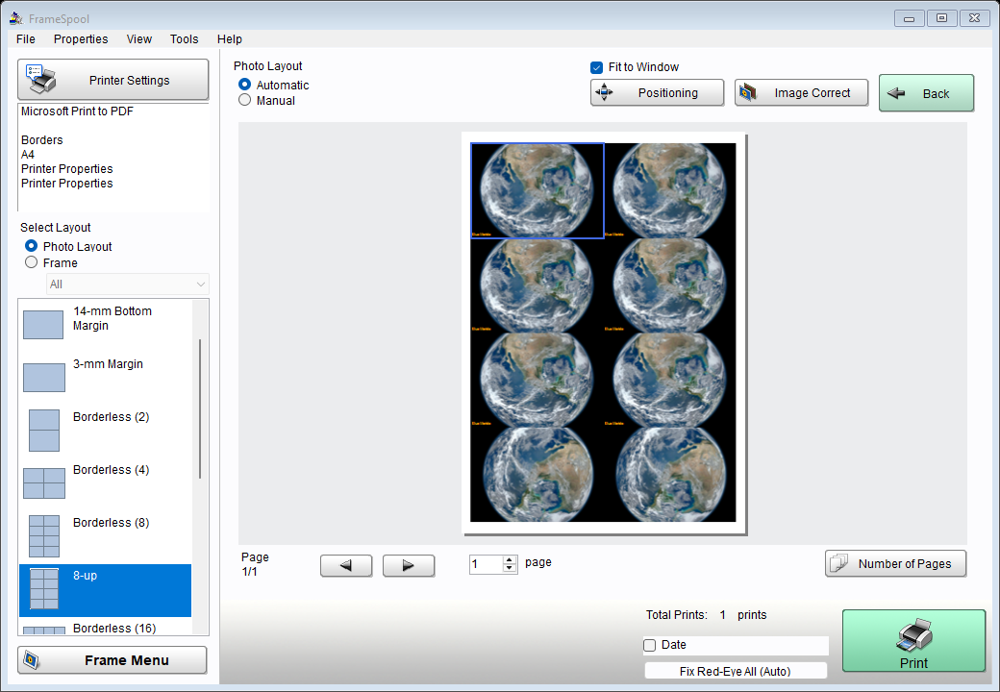
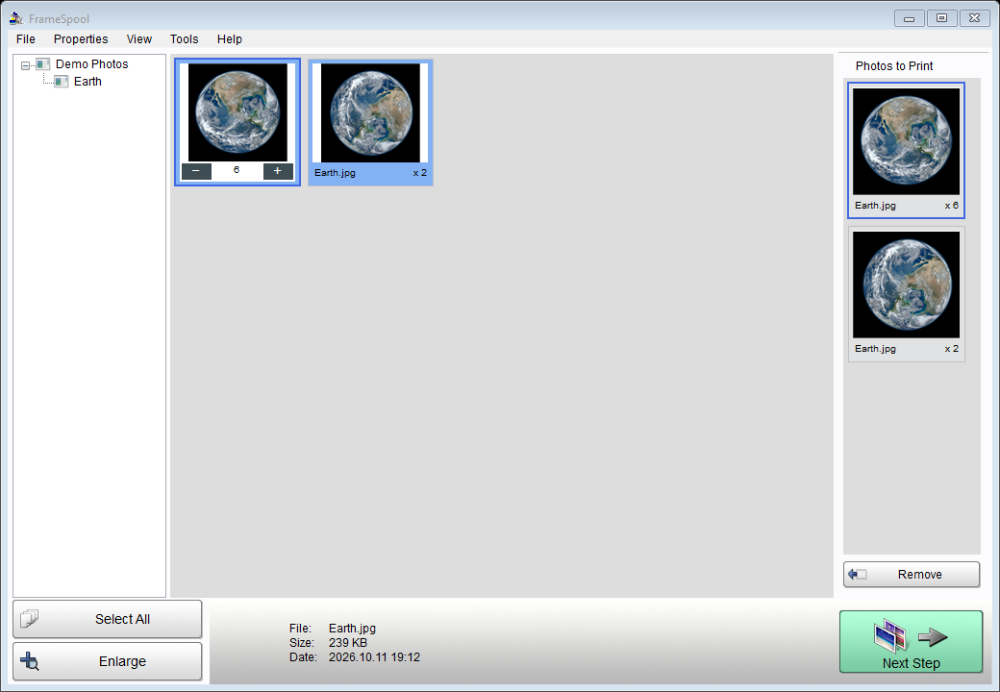
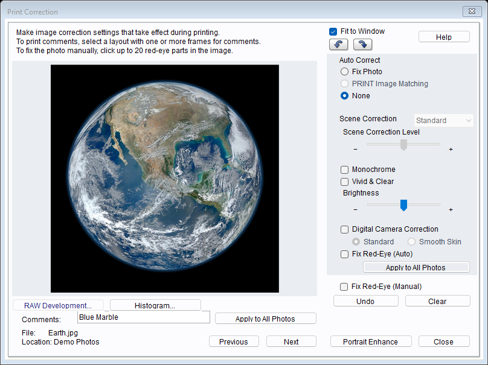
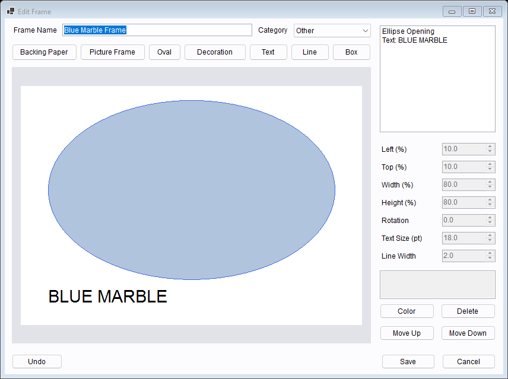
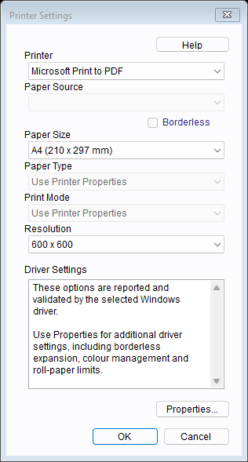

# 📷 FrameSpool

**The familiar photo-printing workflow, with broader printer support.**

[](https://github.com/BanVictor17/FrameSpool/releases)
[](https://github.com/BanVictor17/FrameSpool/releases/tag/v0.2.2)
[](https://github.com/BanVictor17/FrameSpool/actions/workflows/windows.yml)
[](LICENSE)

FrameSpool is a **replacement for Epson Easy Photo Print, built from scratch** as an independent Windows application. Select your photos, arrange them on paper, crop or correct them, then print or export the finished pages.

It keeps the classic workflow and familiar artwork while using **installed Windows printer drivers for broader printer support**, including a driver-based path for newer models such as the L8050. The old application's printer whitelist is removed. Actual L8050 paper output still needs hardware testing.



<p align="center">
  <a href="https://github.com/BanVictor17/FrameSpool/releases/tag/v0.2.2"><b>Download v0.2.2</b></a> ·
  <a href="#what-you-can-do">Features</a> ·
  <a href="#screenshots">Screenshots</a> ·
  <a href="#printing">Printer setup</a> ·
  <a href="ROADMAP.md">Roadmap</a>
</p>

## What you can do

| Feature | What it does |
| --- | --- |
| **Photo selection** | Browse folders, open or drop files, select photos and set copies. Keyboard navigation and cancellable batches are included. |
| **143 print layouts** | Arrange single photos, multiple photos, index sheets, stickers and ID layouts, with sheet and roll-paper formats. |
| **Cropping and placement** | Zoom, fit, move and rotate each placed photo. Repeated copies keep independent crops. |
| **Image corrections** | Adjust brightness and scenes, monochrome, red-eye and portrait controls; preview the corrected result. |
| **Camera RAW** | Develop supported RAW files, change exposure and white balance, and inspect RGB histograms. |
| **Color profiles** | Convert embedded RGB ICC profiles to sRGB before corrections. |
| **Editable frames** | Create frames with rectangular/oval openings, artwork, text and lines. Import compatible legacy templates and share `.fspframe` packages. |
| **Quick Print A/B** | Save layout/driver presets and create desktop shortcuts that accept dropped photos or folders. |
| **GitHub updates** | Check the latest stable release, verify its checksum and update the portable EXE or installed MSI. |
| **Printing and export** | Print through a Windows driver or export 300dpi PNG pages. Open the app without a connected printer. |

The interface follows Windows display scaling, including monitor changes. Small screens can scroll the workspace.

Thumbnails and page/correction previews render in the background, keeping resizing and positioning responsive. The app opens directly into photo selection.

The portable EXE includes its artwork, layouts, RAW decoder and .NET runtime. **No separate .NET installation or original Epson application is required.**

Application code was written independently; recovered artwork/layout data is reused with the maintainer's confirmed redistribution permission. Exact proprietary image processing and complete 1:1 output equivalence are not established. See [the remaining work](ROADMAP.md) and [asset notices](ASSET_NOTICES.md).

## 📦 Download and run

**Windows 10/11, 64-bit.** Choose how you want to run it:

| Download | Best for |
| --- | --- |
| [**Portable EXE**](https://github.com/BanVictor17/FrameSpool/releases/download/v0.2.2/FrameSpool-0.2.2-win-x64.exe) | One file: download and open. Move or rename it as needed. |
| [**MSI installer**](https://github.com/BanVictor17/FrameSpool/releases/download/v0.2.2/FrameSpool-0.2.2-win-x64.msi) | A regular installation with a Start menu shortcut, upgrades and Windows uninstall support. |
| [**Portable ZIP**](https://github.com/BanVictor17/FrameSpool/releases/download/v0.2.2/FrameSpool-0.2.2-win-x64-portable.zip) | The same EXE with documentation, notices and decoder source alongside it. |

The installer uses `%LOCALAPPDATA%\Programs\FrameSpool` for the current account. Preferences and photos are preserved when uninstalling. An optional desktop shortcut can be enabled with `msiexec /i FrameSpool-0.2.2-win-x64.msi INSTALLDESKTOPSHORTCUT=1`.

Embedded license texts and decoder source are available in **Help > About > Licenses**. [SHA256 checksums](https://github.com/BanVictor17/FrameSpool/releases/download/v0.2.2/SHA256SUMS.txt) accompany each release.

**Updates:** choose **Help > Check for Updates** (also in About). Portable copies replace their current EXE, including renamed copies; installed copies run the new MSI and preserve their installation location. The app checks stable releases only, downloads on your request, verifies GitHub’s SHA256 digest, then restarts. Preferences and frames are kept; the current photo selection closes. Updating needs internet access and permission to write the app’s folder. Version 0.2.1 and earlier need this release downloaded manually to get the update button.

No developer tools or network connection are needed to run it. It extracts bundled native runtime/decoder files into user-writable caches on first use; a writable temporary/profile directory is required. Releases are currently unsigned.

## Screenshots

Actual FrameSpool windows using demonstration images; click a screenshot for the full view.

| Choose your photos | Preview print corrections |
| --- | --- |
| [](docs/screenshots/select-photos.png) | [](docs/screenshots/corrections.png) |
| **Edit a frame** | **Choose driver settings** |
| [](docs/screenshots/frame-editor.png) | [](docs/screenshots/printer-settings.png) |

The Blue Marble demonstration image is credited to [NASA, PIA18033](https://images.nasa.gov/details/PIA18033). Screenshot source/credits are in [docs/screenshots/README.md](docs/screenshots/README.md).

## Getting started

1. **Choose photos.** Open a folder or drop files into FrameSpool, select images and set copies.
2. **Choose paper and a layout.** Click **Next Step**, then **Printer Settings** and a layout.
3. **Adjust the result.** Use **Positioning** for cropping and **Image Correct** for print corrections.
4. **Print or export.** Send the pages to your Windows printer queue, save a PDF through a virtual printer, or export PNG pages.

### Photo and frame tools

Select a photo folder, use **File > Open Photos/Open Folder**, or drop photos/folders onto the app. Click photos to select them and use plus/minus for copies. Arrow keys change focus; Space toggles selection and Delete removes a selection. Large imports can be cancelled. Choose **Next Step**, paper and a layout.

**Positioning** adjusts each placed copy's crop, scale, offset and rotation. **Manual** places and moves photos in slots. Right-click a placed photo and choose **Clear Settings** to remove it; invalid drops keep it in place. Repeated placements have independent crops and share source corrections. Zero page copies skips that page.

**Image Correct** previews print/export corrections; the main preview shows source colors. **RAW Development** provides -3 to +3 EV in half-stop increments and seven white-balance choices. **Histogram** shows RGB levels. JPEG, TIFF, PNG, BMP, GIF and supported camera RAW files work. Embedded RGB ICC profiles convert to sRGB through Windows ICM. Unsupported/corrupt profiles or camera compression modes report errors. See [decoder details](third_party/LibRaw/README.md).

**Frame Menu > Create/Edit Frame** creates rectangular/oval openings, artwork, text and lines. Import compatible EPPIF 3.1 single-page 360dpi FD2/PIF templates, images, earlier `.eppframe.json` files or `.fspframe` packages. **Export Selected Frame** creates a portable `.fspframe` package containing artwork and editable geometry. It does not export a legacy PIF.

**Tools > Register Quick Print Settings** saves A/B presets and can create desktop shortcuts. Drop photos or folders onto a shortcut to print with its saved layout and driver settings. The confirmation preference controls Quick Print confirmation. The printer must have a usable installed Windows queue.

Preferences, presets, frames, errors and RAW caches live under `%LOCALAPPDATA%\FrameSpool`. Source photographs are never rewritten.

<a id="printing"></a>

## 🖨️ Printing

Install the printer's Windows driver and choose its queue under **Printer Settings**. Media, quality, resolution and borderless controls use options reported by that driver and validate their combination before printing. **Properties** exposes additional options, including expansion and printer color management. Drivers without Print Schema controls use Properties. The driver can adjust incompatible combinations into supported settings; these successful adjustments are accepted. Printer Settings and the final print dialog save the complete accepted configuration immediately, even if a later print job fails. Subsequent jobs restore native settings instead of reapplying stale choices. Saved device-specific settings are retained only for the same queue/compatible driver.

The L8050 path uses its normal Windows driver, without the old compatibility whitelist. Actual L8050 paper output has not been tested. Check paper size, orientation, borderless expansion, media, quality and color on hardware before relying on it for production.

Use **Microsoft Print to PDF** without hardware or **File > Export pages** for cancellable 300dpi PNG output. **Manual Print** bypasses app correction filters. Roll length follows each photo's aspect ratio; the physical driver/printer must support that custom paper length.

## Build and verify

```powershell
.\setup-build-tools.ps1   # Downloads checksum-pinned .NET SDK and WiX into obj\tools
.\build.ps1 -Installer
.\verify.ps1
.\verify-updater.ps1
.\verify-installer.ps1
.\package-release.ps1
```

An installed compatible .NET 10 SDK can also be used. Runtime version is pinned to 10.0.12. The app is written to `dist\FrameSpool`; release assets are in `dist\release`. WiX 3.14.1 builds the per-user MSI. Native decoder binaries are checked in with complete unmodified upstream source and rebuilding instructions. SDK/WiX tools and research binaries are excluded from Git.

Standalone verification copies only the EXE into an empty folder. Generated fixtures test layouts, rendering, crops, corrections, RAW, ICC conversion, frame packages, UI workflows and installed-driver settings without physical printing. Updater fixtures cover metadata validation, checksum failures, cancellation and portable rollback. DPI fixtures exercise 100%, 125%, 150% and 200% layouts. MSI verification installs into an isolated test folder, upgrades through the real updater helper, runs app checks and uninstalls. CI also checks upgrade from a generated older MSI. Do not run MSI verification over an existing installed copy.

The optional `FrameSpool.exe --print-test <verification-output-folder>` command sends a generated fixture to Microsoft Print to PDF. Full reference equivalence and physical output are separate tasks.

## License

New source and scripts: [MIT](LICENSE). Recovered data: [asset notices](ASSET_NOTICES.md). Runtime/decoder: [dependency notices](THIRD_PARTY_NOTICES.md). Keep third-party terms and corresponding source available when redistributing.
